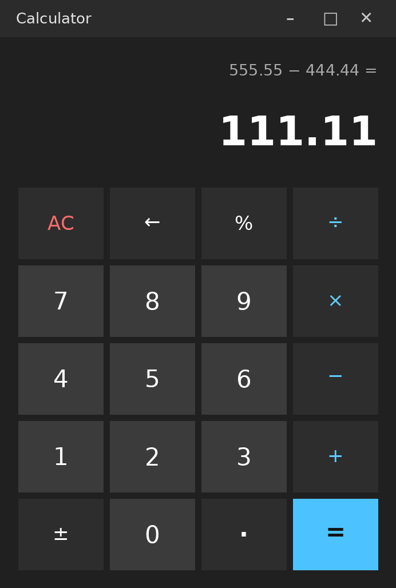

# Desktop-Based Calculator

A simple desktop calculator made with **C# Windows Forms** (.NET Framework 4.8) for the C# lab.
It has a dark modern design, shows the full calculation above the answer, and also works with the keyboard.

## Features

- Addition, subtraction, multiplication and division.
- Shows the calculation (for example `5 + 3 =`) above the answer.
- Chain calculations: `2 + 3 × 4 =` works step by step.
- Decimal numbers, percent (`%`), plus/minus (`±`) and backspace (`←`).
- Clear error message for dividing by zero.
- Keyboard support: numbers, `+ - * /`, `.`, `%`, `Enter` (=), `Backspace`, `Esc` (clear).

## Requirements

- **Windows**
- **Visual Studio 2019 or 2022** (Community edition is free) with the **.NET desktop development** workload –
  download from [visualstudio.microsoft.com](https://visualstudio.microsoft.com/)

## Clone the Project

```bash
git clone https://github.com/munshi-rishad/CSharpLab-Desktop-Based-Calculator.git
```

## How to Run

1. Install Visual Studio and select **.NET desktop development** during setup.
2. Open the cloned folder and double-click `DesktopCalculator.sln` (it opens in Visual Studio).
3. Press **F5** (or click **Start**) to build and run.
4. The calculator window opens in the middle of the screen.

> If Visual Studio asks for **.NET Framework 4.8 Developer Pack**, click the install link it shows, then open the project again.

## Project Structure

```
CSharpLab-Desktop-Based-Calculator/
├── DesktopCalculator.sln              # open this in Visual Studio
├── DesktopCalculator/
│   ├── CalculatorForm.cs              # calculator logic (buttons, keyboard, math)
│   ├── CalculatorForm.Designer.cs     # design: colors, buttons and their positions
│   ├── CalculatorForm.resx
│   ├── Program.cs                     # starts the app
│   ├── App.config
│   ├── DesktopCalculator.csproj
│   └── Properties/
└── Screenshots/
```

## Screenshot

Dark theme with the calculation on top, a big answer, blue operators and a blue `=` button.


